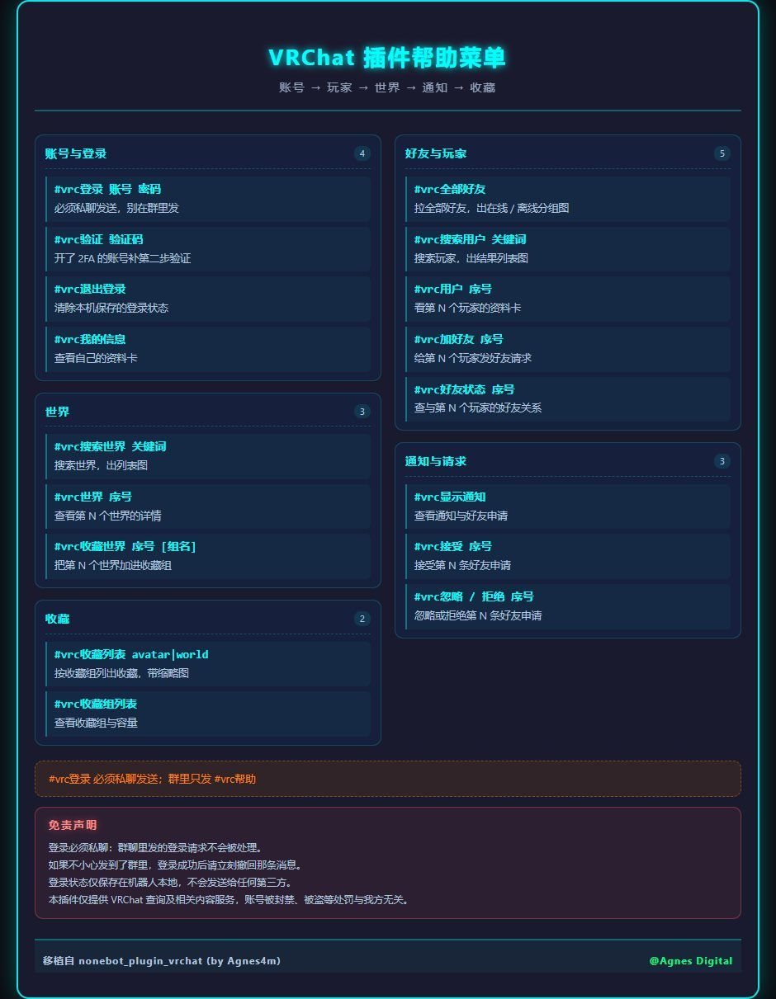
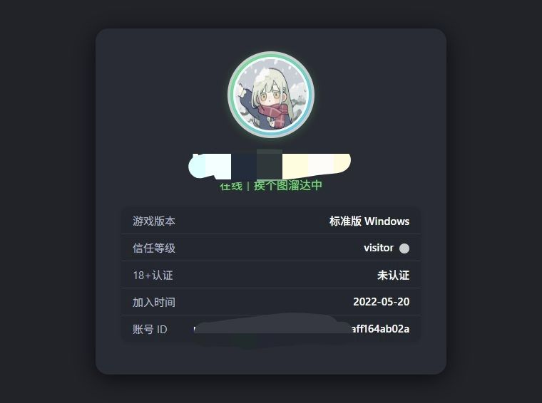
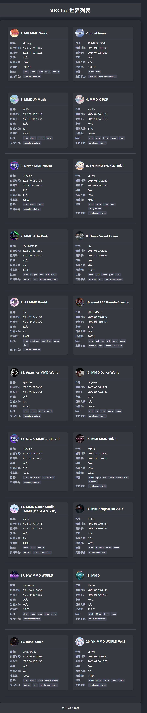

# vrc-plugin

云崽（Yunzai）能用的VRChat查询插件，从[nonebot_plugin_vrchat](https://github.com/Agnes4m/nonebot_plugin_vrchat)搬过来的（Agnes4m写的，MIT）。出图模板照原插件做的，把Jinja2换成了JS拼装。

能查自己的资料、好友列表、在线的好友在哪个世界（视奸神器啊）、玩家搜索、世界搜索、通知和收藏，登录用你自己的VRChat账号，登一次就行，会话存在本地。

## 截图

`#vrc帮助`，指令按账号、玩家、世界、通知、收藏分组：



`#vrc我的信息`，自己的资料卡：



`#vrc搜索世界 关键词`，两列的世界列表，带作者、容量、标签和缩略图：



## 先说清楚：这插件是AI写的

本插件含有大量vibe coding内容，所以：

- 能看出一股AI味，有些地方写得啰嗦，结构也不一定讲究；
- 只在Windows+TRSS-Yunzai上跑过，Linux和其他分支的Yunzai没测，理论上能跑；
- 上游以后再更新，我大概率不会跟着追；
- 有bug直接提issue，等不及自己fork改。

介意就别装了，用上游的NoneBot版或自行二改。

## 安装

### 用Git安装（推荐）

在云崽根目录开终端：

```bash
cd plugins
git clone https://github.com/HUTao1145141919810/vrc-plugin.git
cd vrc-plugin
pnpm install
```

装完重启云崽，发`#vrc帮助`能出帮助图就算装好了。

出图用的是云崽根目录的puppeteer和系统里的Chrome/Chromium，正常整合包都有，不用额外装。出不了图看下面「图出不来」那条。

### 手动安装

1. 下载本仓库代码；
2. 解压成`plugins/vrc-plugin`；
3. 重启云崽。

zip解压装的没有`.git`，`#vrc更新`用不了，以后只能重新下覆盖，别把`data/`盖了。

## 配置

`data/config.json`，第一次启动自动生成：

| 字段 | 说明 |
| --- | --- |
| `contact` | 拼进UA的邮箱。域名得是真的，qq.com、gmail.com都行，`example.com`这种假域名Cloudflare直接403 |
| `avatarBase64` | 头像转base64内嵌渲染。关掉出图快点，但头像会变成默认图 |
| `sessionTimeout` | 等2FA验证码的秒数，默认120 |
| `maxFriends` | 好友列表最多拉多少，默认300 |
| `jpegQuality` | 出图质量 |
| `proxy` | 图片/头像下载用的代理，默认空=全直连 |
| `proxyMode` | `off`只直连/`fallback`直连失败再走代理/`always`先走代理 |

### 代理

默认不走代理，全直连。国内直连`api.vrchat.cloud`首包经常要6~10秒，图片也偶尔拉不下来，遇到了再填：

```json
{ "proxy": "http://127.0.0.1:7890", "proxyMode": "fallback" }
```

`fallback`是先直连、连不上才切代理，只让图片请求走代理，API还是直连（VRChat对代理出口的风控更严）。`always`就是图片全先走代理。

## 更新

git clone装的，主人发指令就行：

| 发什么 | 干了啥 |
| --- | --- |
| `#vrc更新` | 拉一下，只做fast-forward，不动你本地改的东西 |
| `#vrc强制更新` | 直接reset到远端，本地没提交的改动会没（`data/`、`node_modules`被`.gitignore`挡着，不受影响） |

更新完重启云崽才生效。

## 指令

| 指令 | 作用 |
| --- | --- |
| `#vrc帮助` | 帮助图 |
| `#vrc登录 账号 密码` | 登录，只能私聊发 |
| `#vrc验证 验证码` | 开了2FA的号补第二步 |
| `#vrc退出登录` | 清掉本机存的登录状态 |
| `#vrc我的信息` | 自己的资料卡 |
| `#vrc全部好友` | 好友列表图，在线/网页在线/离线分组，序号1..N连着排 |
| `#vrc搜索用户 关键词` | 搜玩家，最多10个，两列出图 |
| `#vrc用户 序号` | 看第N个玩家的资料卡，吃最近一次的好友列表或搜索结果 |
| `#vrc加好友 序号` | 给第N个发好友请求，已是好友或发过请求会直接告诉你 |
| `#vrc好友状态 序号` | 查和第N个的好友关系 |
| `#vrc收藏世界 序号 [组名]` | 把搜到的第N个世界塞进收藏组，不给组名就进默认组 |
| `#vrc搜索世界 关键词` | 搜世界，出列表图 |
| `#vrc世界 序号` | 看搜到的第N个世界的详情 |
| `#vrc显示通知` | 通知图，好友申请/邀请/踢人投票/消息 |
| `#vrc接受 序号`、`#vrc忽略 序号`、`#vrc拒绝 序号` | 处理第N条好友申请 |
| `#vrc收藏列表 avatar\|world` | 收藏按组出图，带名字、作者、缩略图 |
| `#vrc收藏组列表` | 收藏组，纯文字 |

`#vrc 帮助`中间带空格也认。

## 账号与安全

这插件查的是**你自己提供的VRChat账号**，不是公共查询服务，所以必须由你本人登录一次才用得起来。

- 登录发`#vrc登录 账号 密码`，**只能在私聊**。
- 群聊里发，等于当着全群的面把账号密码摊开，后台日志还会留一份。所以群里发来的登录请求一律不处理，只提示你撤回。
- 密码只在登录那一下用，存下来的是登录态，在`data/users.json`，明文密码不落盘。
- 一个群友一个号，按QQ号分开存，互不影响。
- 换号或者不想用了，发`#vrc退出登录`，内存和文件一起清。
- `data/users.json`等于你的账号，别提交到仓库，也别打包发给别人，`.gitignore`里已经排掉了。

## 常见问题

**第一次发指令，机器人回“尚未登录，或登录信息失效”？**

多半是机器人刚启动，还没连上VRChat，或者本地存的登录态还没恢复到内存。再发一次通常就好了。一直这样说明网络连不上`api.vrchat.cloud`，可以按「代理」那节配一下代理再试，或者重新`#vrc登录`一次。

**为什么登录非要在私聊？**

因为这插件得用你自己的账号密码登录。在群聊里发，跟在大街上裸奔没区别——全群都看见，日志里还留一份。

**图出不来，或者好友头像全是灰的？**

先看日志有没有`未找到puppeteer`或者`没找到系统Chrome`，有的话说明云崽根目录缺puppeteer或系统没装Chrome。日志没报错就是VRChat的图片接口拉不动，国内基本是网络问题，按「代理」配一下。

**`#vrc更新`提示“不是git安装”？**

说明插件是zip解压进去的，目录里没有`.git`。这种情况只能重新下载覆盖文件，覆盖时别把`data/`盖了。

**直连特别慢，一条指令要等十几秒？**

VRChat在国内直连首包就要6~10秒，正常现象。配上代理会快很多，见「代理」。

**原插件的群组、经济指令呢？**

没搬。原插件这部分单个文件42KB，体量太大，暂时也不打算搬。

## 与原插件的区别

出图模板照原插件做的，行为上有这几处改动：

- 选序号不用像原插件那样连续对话，搜完直接发`#vrc用户 N`或`#vrc世界 N`；
- 加好友、查好友状态、收藏世界做成了单独指令，原插件是把它们塞在搜索的后续对话里；
- 收藏列表能出图了，带名字、作者和缩略图。原插件这块只输出文字和`wrld_xxx`这种ID，帮助里也标着「未完成」，这边每组最多显示24个；
- 群组、经济模块没移植。

## 致谢

- [Agnes4m/nonebot_plugin_vrchat](https://github.com/Agnes4m/nonebot_plugin_vrchat)：原插件，功能、出图模板、帮助和文案都照它来的，没它就没这个仓库。
- [vrchatapi-python](https://github.com/vrchatapi/vrchatapi-python)：原插件致谢里列的，Python版的VRChat API封装。这边用的是它的JS版[vrchatapi-javascript](https://github.com/vrchatapi/vrchatapi-javascript)，npm包名叫`vrchat`。
- [TRSS-Yunzai](https://github.com/TimeRainStarSky/Yunzai)：插件框架，指令、消息和图片都靠它。
- [puppeteer](https://github.com/puppeteer/puppeteer)：出图用的无头浏览器。

## 许可与免责

MIT，全文见[LICENSE](LICENSE)。

- 原插件是Agnes4m的[nonebot_plugin_vrchat](https://github.com/Agnes4m/nonebot_plugin_vrchat)，也是MIT，模板和功能都照它来的；
- 功能仅限交流学习，禁止任何盈利行为；
- VRChat的名字、素材归VRChat Inc.，这插件只调公开API，不带任何游戏资源；
- 登录用的是你自己的vrc账号，如遇封号、被盗等风险，均与插件作者没有任何关系。
